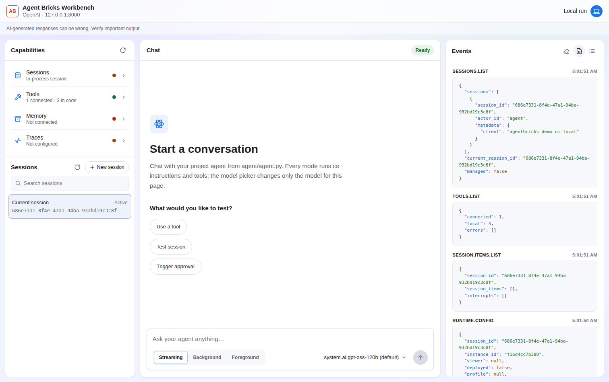
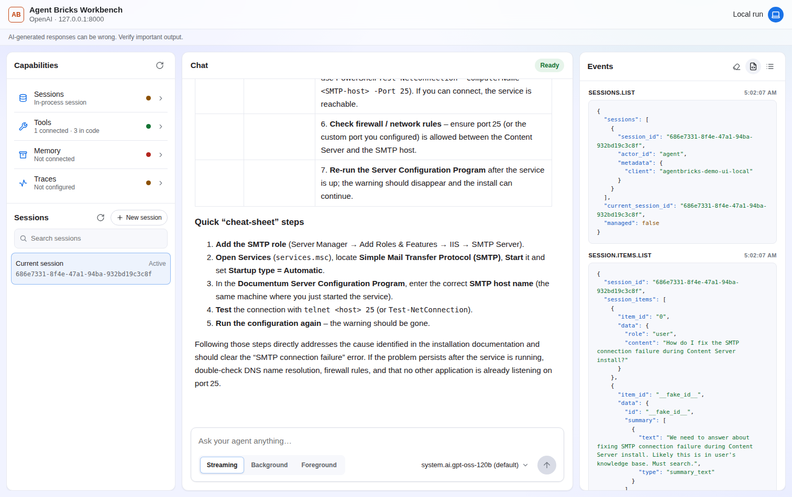
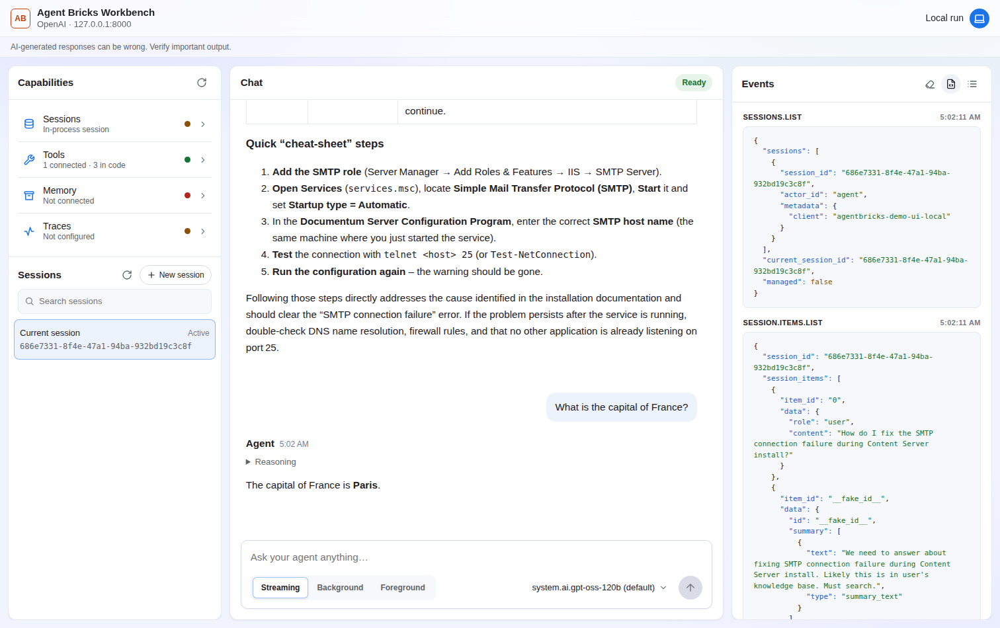

# SupervisedAgent — knowledge-grounded assistant (OpenAI Agents SDK on Agent Bricks)

An OpenAI Agents SDK agent served by `databricks_agentkit.DurableAgentServer`. The managed runtime keeps invocation state and
events in memory during `agentbricks dev`. Deployment attaches a persistent Runtime Store, so invocation
state and events survive process loss and interrupted work can be recovered.

The generated project separates portable agent execution from the managed HTTP protocol:

```text
client -> runtime/main.py -> runtime/adapter.py -> agent/agent.py:run_agent
```

- `agent/agent.py` owns the framework-native agent, sessions, tools, MCP lifetime, HITL state, and
  `run_agent`.
- `agent/checkpoints.py` persists the example's checkpoints through the Session Store.
- `runtime/adapter.py` owns the agent-author integration hooks: runtime input/output translation plus
  `invoke` and `recover`.
- `runtime/main.py` constructs the server and registers those hooks.

To bring an existing Agents SDK agent, keep its normal execution code in `agent/agent.py`, expose a
`run_agent` function that returns the native streaming result, and make only the small payload/event
mapping changes needed in `runtime/adapter.py`.

## What this agent does

This deployment is a knowledge-grounded (RAG) assistant with human-in-the-loop approval for
side-effecting actions:

- **Grounded answers over the user's documents.** For any question about the user's own knowledge
  base the agent calls `search_knowledge`, grounds its answer in the retrieved passages, and cites
  the source `file_name` (and `page_uris` when present). If nothing relevant is found, it says so
  instead of answering from general knowledge.
- **Long-term memory.** With a Memory Store bound (after deploy), the agent saves and recalls
  facts across conversations, keyed by `input.actor`. Under `agentbricks dev` memory is off.
- **Human approval gates.** Tools listed in `REQUIRE_APPROVAL` (`agent/agent.py`) pause the run
  before executing; the client receives an `interrupt` event and resumes with approve/reject
  decisions on the same session. Pending approvals survive restarts through the checkpoint
  harness in `agent/checkpoints.py`, which stores SDK pause state separately from the transcript.
- **Crash recovery.** The runtime's `recover` hook replays the original input against the same
  session, prepending a developer note that prior side effects may have partially completed.
  An approval already accepted by the harness is never rerun.
- **Model access through the Unity Gateway.** The default model is `system.ai.gpt-oss-120b`,
  reached via the AI Gateway route (`use_ai_gateway=True`); callers may override it per request
  with `input.model`, and `agentbricks experimental models bind/upgrade` can swap it without code
  changes. Runs are traced with MLflow to `/Shared/agentbricks_traces/newagent-oqmsfn`.
- **Durable, idempotent API plus chat UI.** Foreground, background, and streaming (SSE) invocation
  modes, invocation-ID idempotency, event replay from a cursor, and a browser chat app that pins
  a session to one replica with the `X-Routing-Key` header.

## Tools

As wired in `create_agent` (`agent/agent.py`). `*all_tools()` (auto-discovery of every module in
`agent/tools/`) is intentionally commented out in favor of an explicit, narrowed list — add a tool
to that list to activate it.

| Tool | Kind | Source | Approval | Purpose |
| --- | --- | --- | --- | --- |
| `search_knowledge` | local function tool | `agent/tools/knowledge_search.py` | no | RAG retrieval over the Vector Search index |
| `get_current_time` | local function tool | `agent/tools/sample_tool.py` | no | Current date/time (ISO-8601) |
| memory tools | runtime-bound | `memory_tools(actor)` | no | Save/recall long-term facts by actor |
| Genie tools | runtime-bound | `genie_tools(...)` | no | Q&A against bound Genie spaces |
| `get_last_purchased_item` | UC function (MCP) | `agent.toml` `[[tools]]` | no | Look up a customer's last purchase |
| `send_message` | local function tool | `agent/tools/send_message.py` | **yes** | Side-effecting sample; currently inactive |

### `search_knowledge` — knowledge-base retrieval (RAG)

Queries the Databricks AI (Vector) Search index `agentic_ai.03_gold.search_index` on endpoint
`search_rag_new` and returns the `num_results` most similar chunks (default 5) as JSON: `chunk_id`,
`file_name`, `chunk_to_retrieve` (the passage text), `page_uris`, and the similarity `score`.

- The index is Delta-synced from `agentic_ai.03_gold.final_chunk`, embedding `chunk_to_embed`
  with `databricks-qwen3-embedding-0-6b` (hybrid keyword + vector search).
- When an MLflow trace is active (agent runs), the query opens a `RETRIEVER` span whose output is
  the list of chunk dicts — the contract MLflow's retrieval scorers read during evaluation.
- If the index or endpoint is unavailable (still provisioning, pipeline not synced), the tool
  returns a short, actionable message instead of raising, so the model can inform the user.
- Importing the module needs no Databricks auth; the workspace client resolves only at call time,
  keeping hermetic tests clean.

### `get_current_time`

Returns the server's current date and time in ISO-8601. The template's harmless read-only example
of the `@function_tool` pattern.

### Memory tools

`memory_tools(actor)` binds long-term memory — durable facts the agent saves and recalls across
conversations — for the given `actor`. Off under `agentbricks dev`; backed by the bound Memory
Store (`newagent-oqmsfn-memory`) after deploy.

### Genie tools

`genie_tools(workspace_client_for=...)` exposes bound Genie spaces as Q&A tools, optionally
executed on behalf of the signed-in request user; see
[Request-user authorization](#request-user-authorization).

### `get_last_purchased_item` — Unity Catalog function tool

Declared in `agent.toml` under `[[tools]]` as a `uc_function` tool wrapping
`agentic_ai.ai_services.get_last_purchased_item` (parameter `cust_name`, backed by
`agentic_ai.ai_services.customer_info`). CLI-declared manifest tools surface to the agent as MCP
servers via `mcp_servers()`; the model-facing tool name is
`agentic_ai__ai_services__get_last_purchased_item`.

### `send_message` — approval-gated sample (currently inactive)

Defined in `agent/tools/send_message.py` with `needs_approval=True` and listed in
`REQUIRE_APPROVAL`, so a call would pause the run for an approve/reject decision before anything
is sent. It is a placeholder for a real email/Slack/SMS integration. Because `create_agent` uses
the narrowed explicit tool list, it is **not currently offered to the model** — re-add it (or
restore `*all_tools()`) to exercise the human-approval flow end to end.

### MCP servers

`agent/mcps.py` (`build_mcp_servers()`) returns an empty list by default, so the agent runs with
only the MCP servers derived from `agent.toml`. Add servers there or via `agentbricks tools add
mcp`; servers that fail to connect or list tools are skipped with a warning, while request-user
(OBO) or auth errors fail the run outright.

The `websearch` notebook under `agent/tools/` is an empty placeholder cell, not a functional tool.

## Run locally

```bash
agentbricks dev
```

The API is available at `http://localhost:8000/api/invocations`, or on the port you pass with
`--app-port`. Requests can fail for a few seconds while the server starts; wait for
`Uvicorn running on ...` in the log.

### Running inside Databricks compute

`agentbricks dev` shells out to the interactive Databricks CLI and does not work on Databricks
compute (serverless or a cluster). The equivalent direct route there:

```bash
# DATABRICKS_HOST / DATABRICKS_TOKEN come from the SDK, e.g. WorkspaceClient().config.authenticate()
PYTHONDONTWRITEBYTECODE=1 .venv/bin/python -m uvicorn runtime.main:app --host 127.0.0.1 --port 8000
```

Cold start takes roughly two minutes; an invocation then completes in seconds. Two gotchas on
compute: the copied `.venv`'s `start-server` script has a shebang pointing at the original
project's interpreter (gone), so launch through `.venv/bin/python -m uvicorn` instead, and set
`PYTHONDONTWRITEBYTECODE=1` because `.venv` sits on the `/Workspace` FUSE mount where
`__pycache__` writes fail. Background processes must be terminated within the same cell/run
that started them.

Every request supplies a UUID `id`.
That ID is the invocation identifier and idempotency key. Supply the stable application session as
the top-level `session_id`; agent-specific values live inside the opaque `input` object:

```bash
SESSION_ID=$(uuidgen)
INVOCATION_ID=$(uuidgen)

curl -sS http://localhost:8000/api/invocations \
  -H 'Content-Type: application/json' \
  -d "{\"id\":\"$INVOCATION_ID\",\"session_id\":\"$SESSION_ID\",\"input\":{\"messages\":[{\"role\":\"user\",\"content\":\"What time is it? Use your tool.\"}]}}"
```

Reuse `SESSION_ID` for multi-turn conversation history. Generate a new `INVOCATION_ID` for each
turn. Retrying the same request with the same invocation ID returns the persisted result; changing
the request while reusing the ID returns `409`.

## Long-term memory

The Session Store keeps one conversation's state, keyed by the top-level `session_id`. The Memory Store
keeps facts the agent recalls across conversations, keyed by `actor`: `runtime/adapter.py` reads
`input.actor` and passes it to `memory_tools(actor)`. If you leave out `actor`, it defaults to the
`session_id`, so long-term memory won't carry across sessions. For memory that persists, pass a stable
`actor`, such as the end user's ID, from trusted application context. With a request-user
(`auth = "user"`) tool bound, the adapter also namespaces a supplied `actor` to the signed-in user; see
[Request-user authorization](#request-user-authorization).

Memory is off by default under `agentbricks dev`, so try it against the deployed app: two
invocations with different `session_id`s and the same `actor`.

```bash
ACTOR=user-123

# Conversation 1: the agent saves a fact with its memory tool.
agentbricks --profile <profile> endpoint invoke agent-bricks-<name> --path /api/invocations \
  --json "{\"id\":\"$(uuidgen)\",\"session_id\":\"$(uuidgen)\",\"input\":{\"actor\":\"$ACTOR\",\"messages\":[{\"role\":\"user\",\"content\":\"Remember that I prefer answers as bullet points.\"}]}}"

# Conversation 2: a new session_id, same actor, so the agent can recall it.
agentbricks --profile <profile> endpoint invoke agent-bricks-<name> --path /api/invocations \
  --json "{\"id\":\"$(uuidgen)\",\"session_id\":\"$(uuidgen)\",\"input\":{\"actor\":\"$ACTOR\",\"messages\":[{\"role\":\"user\",\"content\":\"How do I like my answers formatted?\"}]}}"
```

## Invocation modes

- Foreground: omit `background` and `stream`; the response contains the agent result under `output`.
- Foreground streaming: set `stream: true`; the response is SSE backed by persisted events.
- Background: set `background: true`; poll the returned `status_url`.
- Background streaming: set both flags; the `202` response includes `status_url` and `events_url`.

```bash
INVOCATION_ID=$(uuidgen)
curl -sN http://localhost:8000/api/invocations \
  -H 'Content-Type: application/json' \
  -d "{\"id\":\"$INVOCATION_ID\",\"session_id\":\"$SESSION_ID\",\"input\":{\"messages\":[{\"role\":\"user\",\"content\":\"Count to three.\"}]},\"stream\":true}"

INVOCATION_ID=$(uuidgen)
curl -sS http://localhost:8000/api/invocations \
  -H 'Content-Type: application/json' \
  -d "{\"id\":\"$INVOCATION_ID\",\"session_id\":\"$SESSION_ID\",\"input\":{\"messages\":[{\"role\":\"user\",\"content\":\"Summarize durable agents.\"}]},\"background\":true}" | jq
curl -sS "http://localhost:8000/api/invocations/$INVOCATION_ID" | jq
```

SSE records contain events translated by `runtime/adapter.py`: token `delta`s, completed `message`s,
and HITL `interrupt`s. Replay from a cursor with
`GET /api/invocations/{id}/events?after={sequence}`.

A message's `content` is its answer text. Models that reason (Claude 5.x) add a separate
`{"role": "assistant", "content": [{"type": "reasoning", ...}]}` message before the answer.

## Human approval

`send_message` requires approval. When output or the event stream contains an `interrupt`, submit a
new invocation with the same application session:

```json
{
  "id": "<new-uuid>",
  "session_id": "<same-session-id>",
  "input": {
    "resume": {"decisions": [{"type": "approve", "call_id": "<action-request-call-id>"}]}
  }
}
```

Supply one decision per `action_requests` entry, in order, using its `call_id`. A decision's `type`
must be `approve` or `reject`; rejections may include a string `message`.

OBO tools (`auth = "user"`) support the same interactive approval flow. The same signed-in user
submits a new invocation with the same `session_id` and, if supplied, `input.actor`. The harness
rebuilds the agent and tool clients using the new request's credentials, then restores the saved
JSON state into that agent. It never retains the previous request's live `RunState` or clients.
The browser normally uses its existing authenticated session; a page refresh or another login is
unnecessary unless that session has expired. Automatic OBO crash recovery remains unsupported.

Malformed decisions return `INVALID_APPROVAL` before consuming the pending approval. Correct the
decision and submit it with a new invocation ID. OpenAI approvals support approve/reject; LangGraph
also supports editing a pending tool call according to its middleware policy.

Pending approvals survive restarts when a Session Store is bound. The harness saves the paused SDK
state separately from conversation history; without a binding, it stays process-local. Invalid
decisions leave the approval intact. A valid decision consumes it before execution, so submitting
it again cannot repeat the action. If execution fails after acceptance, check the invocation and
tool side effects: the outcome may be uncertain, and the approval will not be retried automatically.
You can start a new conversation turn; any later approval prompt requires its own decisions.
Concurrent workers require a shared Runtime Store to serialize invocations within a session.

## Crash recovery

`runtime/main.py` always registers the adapter's `invoke` and `recover` hooks. Both call the same
`agent.agent.run_agent` function. OpenAI Agents SDK does not currently expose LangGraph-style node
checkpoints. An approval already accepted by the harness cannot be recovered by rerunning it. For
other invocations, `recover` replays the original application input against the same session. The
adapter prepends a developer instruction telling the agent that this is a recovery attempt and that
some tool calls or external side effects may already have completed or may still be in progress.
When deployment attaches a Runtime Store, invocation state and emitted events survive process loss
and the runtime can call `recover` on a replacement worker. Without a Runtime Store, invocation state
remains process-local and interrupted work is not automatically recovered. Replayed turns may repeat
external side effects; tools must be idempotent.

## Chat app

The browser UI is included by default. It generates a stable application session ID in local
storage, sends it as the top-level `session_id`, and generates a fresh invocation UUID per turn.
Use `agentbricks init --framework openai --disable-chat-app` for API-only output.

## Example session (captured from a live run)

Captured 2026-11-24 against the real server (started per
[Running inside Databricks compute](#running-inside-databricks-compute)) with the default model
`system.ai.gpt-oss-120b`. One session, two turns:

**Turn 1 — knowledge-base question: retrieved, grounded, and cited.** (abridged; the full answer
walks through all fix steps)

> **User:** How do I fix the SMTP connection failure during Content Server install?
>
> **Assistant:** The installation guide for Content Server 20.3 includes a specific
> troubleshooting note for this error. The root cause is usually that the Windows SMTP service
> is not running (or not set to start automatically). Below is the step-by-step remedy, taken
> directly from the official installation notes (**Content Server 20.3 installation.docx**)…
> 1. Open the Services console (`services.msc`); 2. Locate the "Simple Mail Transfer Protocol
> (SMTP)" service; 3. Start the service; 4. Set the start-up type to Automatic…

The answer names the source document, and the run's MLflow trace carries the RETRIEVER span
from `search_knowledge` with the retrieved chunks.

**Turn 2 — general-knowledge question: answered directly, no retrieval.**

> **User:** What is the capital of France?
>
> **Assistant:** The capital of France is **Paris**.

Turn 2 is by design: the agent's instructions require `search_knowledge` only for questions
about the user's documents. Note this diverges from the no-match control in
`evals/eval_rag.py`, which expects an explicit "nothing relevant found" disclaimer —
see [Evaluations](#evaluations).

### Screenshots (captured from the live UI)

The chat workbench at startup — capabilities panel (sessions, tools, memory, traces), composer
with streaming/background/foreground modes, and the events log:



Knowledge-base question in the same session: the agent retrieves passages with
`search_knowledge` and answers with the step-by-step fix, citing
**Content Server 20.3 installation.docx**:



General-knowledge follow-up: answered directly, no retrieval (see the note above):



Captured with headless Chromium on Databricks compute, against the same server the transcripts
above came from. Note for reproducing: the runtime image lacks three libraries chromium needs
(`libatk`, `libXdamage`, `libatspi`) — fetch them from the signed Debian mirror into a user-local
apt root (`signed-by` keyring → `apt-get update` → `apt-get download` → `dpkg-deb -x` →
`LD_LIBRARY_PATH`), with no root and no system changes.

## Evaluations

`evals/eval_rag.py` measures RAG quality end to end: it runs the real agent (`run_agent`) on a
6-case eval set — five questions about the indexed "Content Server 20.3 installation.docx"
document plus one no-match control ("What is the capital of France?") that must disclaim rather
than answer from general knowledge — and scores each answer with:

- MLflow retrieval judges: `RetrievalGroundedness` (is the answer implied by the retrieved
  passages — no hallucination), `RetrievalRelevance` (were the retrieved chunks relevant), and
  `RetrievalSufficiency` (did the chunks contain enough information to answer).
- Deterministic checks: `cites_source_or_disclaims` (the answer cites the source file or clearly
  says nothing was found) and `retriever_span_present` (the trace carries a RETRIEVER span, the
  instrumentation contract the retrieval judges rely on).

Each case runs in a fresh `eval-*` session so memory never leaks between cases. Eval traces land
in the same experiment as interactive tracing (`/Shared/agentbricks_traces/newagent-oqmsfn`). The
6 cases are a smoke signal over an 11-chunk index, not a statistically meaningful estimate —
grow `EVAL_SET` as more documents are indexed.

```bash
uv run python evals/eval_rag.py
```

Run it where Databricks auth is configured — the same environment `agentbricks dev` works in.

## Tests

```bash
uv run pytest
```

`tests/` covers the agent (`test_agent.py` — construction, approvals, resume), local tools
(`test_tools.py` — hermetic, no Databricks auth), the checkpoint harness (`test_checkpoints.py`),
the runtime adapter (`test_runtime.py`), the demo UI (`test_demo_ui.py`), and live workspace integration (`test_workspace.py` — auto-skips without Databricks credentials).

## Configure and deploy

- Change the model, instructions, tools, and framework-native execution in `agent/agent.py`.
- Change `runtime/adapter.py` only to map a different application input/output contract.
- Add local tools under `agent/tools/`; modules are auto-discovered.
- Add MCP servers in `agent/mcps.py` or with `agentbricks tools add mcp`.
- Bind long-term memory with `agentbricks memory bind <store>`; `agentbricks deploy` creates the
  store if it doesn't exist. Memory and session stores are off by default in `agentbricks dev` (the
  chat app shows "Not connected" for memory locally) and connect after deploy. To start with
  memories already in the store, create it and add entries before you bind and deploy:

  ```bash
  agentbricks memory stores create --name <store>    # prints a Store ID
  agentbricks memory entries create --store <Store ID> --actor-id you@example.com \
    --path /preferences/style.md --content "Prefers concise answers."
  ```

  `--path` is the entry's key in the store, not a file on your machine; the deployed chat app uses
  the signed-in user's email as the actor.
- Route the agent's model through a Unity Gateway model service you own with
  `agentbricks experimental models bind`, then search for a better model and prompt on your own
  eval set with `agentbricks experimental models upgrade`. These commands are experimental, so
  their flags may change between releases.
- Bind durable transcript history with `agentbricks sessions bind <store>`.
  Session stores are off by default in `agentbricks dev`; the binding takes effect after
  `agentbricks deploy`.

```bash
agentbricks --profile <profile> deploy agent-openai --source .
```

When deployment provisions a dedicated Runtime Store, only the app-owned
`databricks_agentkit_runtime_<hash>` schema and runtime tables are added. Managed Runtime Store
deployments use their own default schema.

To keep a session on one app replica (sticky routing), set the `X-Routing-Key` request header to your
stable session id on every call. It is a routing hint only: non-blank, no more than 128 UTF-8 bytes,
used verbatim, and it takes precedence over the legacy `__Host-databricks-app-router` cookie. It is not
authentication and is never used as the application's session id. Send that separately as the
top-level `session_id` in the request body.

# Request-user authorization

Declared tools in `agent.toml` select `auth = "user"` or `auth = "app"`; legacy missing auth
continues to use the application/default identity. Deployed user tools require the request resolver
and never fall back to application credentials. Model, memory-service, session-service, and custom
MCP server credentials are unchanged.

`runtime/main.py` derives the invocation policy after `configure()`. The runtime adapter namespaces
public session IDs and actor values for the request owner, then passes only `workspace_client_for`
to the framework-native agent. Internal session keys are never returned to clients.

User-policy invocations use the existing Runtime for synchronous, streaming, and background calls,
including status polling, event replay, and invocation-ID idempotency. The Runtime Store persists no
credential; request-user authentication remains process-local for the active first attempt. A
replacement attempt fails with `MCP_USER_AUTH_RECOVERY_UNSUPPORTED` before agent code runs.
Interactive approvals use new authenticated invocations and the harness's existing JSON checkpoint
store. Existing namespaced memory and conversation-store behavior is unchanged; OBO does not add
another saver.

Existing generated projects must update their copies of `agent/agent.py` and `runtime/adapter.py`
to remove the OBO pause/resume rejection guards and translate malformed decisions to
`INVALID_APPROVAL`. Upgrading the installed package alone does not rewrite these files. Keep the
runtime's automatic-recovery guard.
